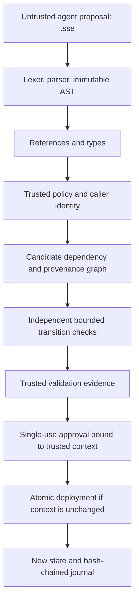

# SSEVOH-DSL

**A domain-specific language and formal assurance framework for safe self-evolution of AI agent harnesses.**

SSEVOH-DSL lets an agent propose changes to its skills, memory, tools, workflows, and configuration while an independent, trusted service decides whether each change may be applied. It checks operator permissions, dependencies, provenance, validation evidence, and bounded lifecycle safety before issuing a single-use approval. Deployment succeeds only if the state approved by the service is still current.

The repository contains a Python reference implementation, a declarative language, formal models and executable assurance checks, a pinned Google Research Harness² integration, and reproducible experiment pipelines. The core is an **in-memory metadata sandbox research prototype**. The integration adds controlled file publication and execution within explicitly bounded domains; arbitrary generated-program safety and production deployment are outside the demonstrated scope.

## Contents

- [The problem and approach](#the-problem-and-approach)
- [Quick start](#quick-start)
- [Understand the language](#understand-the-language)
- [Architecture and trust boundaries](#architecture-and-trust-boundaries)
- [Use the Python API](#use-the-python-api)
- [Reproduce local experiments](#reproduce-local-experiments)
- [Reanalyze the collected studies](#reanalyze-the-collected-studies)
- [Reproduce formal assurance](#reproduce-formal-assurance)
- [Work with the Harness² integration](#work-with-the-harness²-integration)
- [Run experiments on Slurm](#run-experiments-on-slurm)
- [Evidence and research limits](#evidence-and-research-limits)
- [Repository map](#repository-map)
- [Development workflow](#development-workflow)
- [Troubleshooting](#troubleshooting)
- [Documentation, publications, and citation](#documentation-publications-and-citation)

## The problem and approach

An agent harness is the environment around a model: its tools, skills, memory, prompts, workflows, and configuration. Allowing an agent to modify that environment introduces problems that ordinary logging or restoring a backup does not resolve:

| Failure mode | SSEVOH's response |
|---|---|
| A proposal requests an operation or capability the agent does not have. | An operator-owned policy checks the authenticated caller, exact target and operation, and capability ceiling. |
| Changing one component leaves dependent components using incompatible assumptions. | The engine computes the affected closure and quarantines dependent components. |
| A component is derived from a version that has been withdrawn. | Version-level provenance and withdrawal history constrain what may remain active. |
| Rolling back restores a prohibited version or invalid dependency state. | Recovery is a checked transition over retained history, with fresh validation. |
| A proposal claims that it passed its own checks. | Trusted registered validators produce evidence independently of proposal text. |
| Two proposals are approved against the same state and race to deploy. | Single-use approvals and an atomic comparison of the trusted context reject stale commits. |
| An audit trail is altered or replayed without its original context. | Hash-chained records and externally anchored replay checks expose inconsistencies within the stated trust assumptions. |

The central distinction is between **proposing**, **approving**, and **deploying**. A syntactically valid proposal has not earned permission to deploy. A safe admission also does not establish that an agent improved at its task.

For a less technical introduction, read the [research overview](docs/research-overview.md) or [DSL explanation](docs/ssevoh-dsl-explained.md).

## Quick start

Run commands from the repository root. Python **3.11+** is sufficient for the core; use **3.12+** if you also intend to run the pinned Harness² integration. The core has no third-party runtime dependencies.

```bash
python3 -m venv .venv
source .venv/bin/activate
python -m pip install -e .

# Parse and type-check a proposal; print its JSON intermediate representation.
ssevoh compile examples/basic-evolution/example.sse

# Approve and deploy it in a fresh demonstration sandbox.
ssevoh demo examples/basic-evolution/example.sse

# Run the built-in bounded lifecycle verification suite.
ssevoh verify

# Run the core implementation tests.
python -m unittest discover -s tests -v
```

Successful compilation prints the harness snapshot and evolution as JSON. The basic demo prints `revision: 1` and its deployment journal. Verification prints a JSON report with `passed: true` and exits successfully when its checks pass.

The demo creates a policy granting `demo-operator` the example's requested operation. This is an educational convenience: an application must supply its own trusted initial state, policy, and authenticated caller identity.

To work directly from source without installation:

```bash
export PYTHONPATH=src
python3 -m ssevoh.cli compile examples/basic-evolution/example.sse
python3 -m ssevoh.cli demo examples/basic-evolution/example.sse
python3 -m ssevoh.cli verify
```

The quick start requires neither an LLM service nor Java, GPUs, or cluster access. The full formal release check additionally requires Java and TLC; see [formal assurance](#reproduce-formal-assurance).

## Understand the language

A `.sse` file contains one declared harness snapshot and one proposed evolution. This is the complete [basic example](examples/basic-evolution/example.sse):

```text
harness assistant {
  component base memory { version 1; mutable true; }
  component target skill { version 1; mutable true; depends [base]; }
  evolution improve {
    operation update; target target; from 1; to 2;
    depends [base]; requires [structure]; expect active; ensure active;
  }
}
```

This proposes moving `target` from version 1 to version 2 while keeping its dependency on `base`. `requires [structure]` requests a registered validator. The service runs that validator; the declaration supplies no evidence by itself. The declared snapshot must agree with the trusted state and cannot replace it.

| Construct | Meaning |
|---|---|
| `component <name> <kind>` | A versioned `skill`, `memory`, `tool`, `workflow`, `configuration`, `policy`, or `verifier`. |
| `version`, `mutable` | Positive version identity and mutability. Policy and verifier components remain protected regardless of `mutable`. |
| `depends [...]` | Runtime dependency relationships. |
| `parents [...]` | Provenance relationships; removing ancestry without an independent release certificate is unsupported. |
| `capabilities [...]` | Requested capabilities, bounded by the operator's ceiling. |
| `from`, `to` | Expected current version and proposed new or historical version. |
| `requires [...]` | Requested validators, in addition to operator-required validators. |
| `expect`, `ensure` | Finite lifecycle preconditions and postconditions. `expect` accepts `active`, `inactive`, or `any`; `ensure` accepts `active` or `inactive`. |

The three operations have different lifecycle effects:

- **`update`** creates a strictly newer, previously unused version and quarantines affected descendants.
- **`withdraw`** records the current version as withdrawn and deactivates it and affected descendants. It must explicitly `ensure inactive`.
- **`rollback`** restores a known historical version only when current policy, provenance, withdrawal constraints, and validation permit it. Withdrawal history is retained.

Fields end with semicolons; lists use comma-separated names; `#` begins a comment. There are no shell commands, arbitrary predicates, policy grants, component creation/deletion, or self-issued evidence in the language.

Explore all six examples:

| Example | Focus |
|---|---|
| [Basic evolution](examples/basic-evolution/example.sse) | Minimal version update with a dependency. |
| [Skill update](examples/skill-update/example.sse) | Skill evolution metadata. |
| [Memory evolution](examples/memory-evolution/example.sse) | Memory version changes. |
| [Dependency change](examples/dependency-change/example.sse) | A changed dependency declaration. |
| [Tool permission change](examples/tool-permission-change/example.sse) | Capability declarations subject to trusted policy. |
| [Withdrawal](examples/withdrawal/example.sse) | Withdrawal and dependent quarantine. |

See the [language reference](docs/language/language-reference.md), [grammar](docs/language/grammar.ebnf), and [type system](docs/language/type-system.md) for exact rules. `compile` checks the language; runtime authorization and assurance are exercised by the engine.

## Architecture and trust boundaries



The reference `SandboxEngine` keeps immutable state snapshots, version history, provenance, approvals, and journals in memory, with a lock around trusted operations. Approval binds the proposal and candidate to the state, policy, validator registry, history, and provenance context. Deployment rechecks its authority and context before committing.

The proposer must not control the policy, authenticated identity, validator registry, or engine memory. The Python API demonstrates these boundaries inside one process; enforcing separation from a hostile agent requires an appropriate host/process boundary. The default `structure` validator checks metadata structure. Applications need trusted semantic validators for claims about the actual usefulness or behavior of an artifact.

The Harness² adapter extends this model with checked bundles, execution receipts, and library admission. Its supported execution domain is described separately in the [integration contract](integrations/harness2/formal/contracts.md).

Read the [architecture](docs/architecture/overview.md), [lifecycle](docs/architecture/lifecycle.md), [threat model](docs/architecture/threat-model.md), and [formal semantics](docs/architecture/formal-semantics.md) before extending the authority boundary.

## Use the Python API

This executable example uses the same trusted lifecycle as the CLI. Run it with the package installed or `PYTHONPATH=src`:

```python
from pathlib import Path

from ssevoh.assurance import Rejected, SandboxEngine
from ssevoh.compiler import compile_source
from ssevoh.model import State
from ssevoh.policy import Policy

source = Path("examples/basic-evolution/example.sse").read_text()
spec = compile_source(source)

# Bootstrap state and policy in trusted application code.
policy = Policy(frozenset({("developer", "target", "update")}))
engine = SandboxEngine(State(spec.components), policy)

try:
    approval = engine.approve(source, principal="developer")
    engine.deploy(approval)
except Rejected as exc:
    raise SystemExit(f"Proposal rejected: {exc}")

assert engine.state.revision == 1
print(engine.state.mapping()["target"].version)  # 2
print(engine.journal)
```

In an application, obtain `principal` from authentication and initialize `State` from an authoritative source. Subsequent proposals must describe that current state. Keep the same engine instance for its version history; recreating it is not durable recovery. Custom validators are trusted callables passed through `SandboxEngine(..., validators=...)`, and operator-required validator names belong in `Policy.validators`.

## Reproduce local experiments

These commands regenerate deterministic behavior and descriptive summaries without LLM inference. They write into ignored `.cache/` directories to preserve collected research artifacts. Set `PYTHONPATH` even if you installed the package so standalone scripts use the working source.

### 1. Run HeartBench across the four deterministic baselines

[HeartBench v1](benchmark/README.md) contains 20 hand-authored scenarios, 25 actions, and 15 required evolution families.

```bash
export PYTHONPATH=src
python3 -m ssevoh.benchmark \
  --baseline all --repeats 5 \
  --output .cache/reproduction/local/deterministic/records.jsonl

python3 experiments/scripts/analyze.py \
  --root .cache/reproduction/local/deterministic \
  --output .cache/reproduction/local/deterministic-analysis
```

This produces **500 records**: 25 actions × four baselines × five repeats.

| Baseline | What it exercises |
|---|---|
| B0 | Parsing with unrestricted admission. |
| B1 | Initial schema/structure checks. |
| B2 | Compiler, policy, and candidate checks without independent evidence or formal checking. |
| B3 | Full metadata sandbox approval and deployment. |
| B4 | Separate model-generated proposal study under full enforcement; not part of `--baseline all`. |

B0–B2 record admission decisions rather than equivalent end-to-end deployments. Their timing is not a direct measurement of deployment overhead relative to B3. Multi-step cases advance through accepted safe reference setup.

### 2. Run mechanism ablations

```bash
python3 experiments/scripts/ablations.py \
  --repeats 5 --output .cache/reproduction/local/ablations/records.jsonl
python3 experiments/scripts/analyze.py \
  --root .cache/reproduction/local/ablations \
  --output .cache/reproduction/local/ablation-analysis
```

This produces **750 records** across a full control and five synthetic mechanism removals. Read [ABLATIONS.md](experiments/ABLATIONS.md) for omitted gates and retained overlapping checks. These conditions are distinct from formal mutants and from the integration's eight ablations.

### 3. Run graph scaling and conflicting commits

```bash
python3 experiments/scripts/scale.py \
  --sizes 10,100,500 --contenders 1,2,4,8 --repeats 5 \
  --output .cache/reproduction/local/scaling/records.jsonl
python3 experiments/scripts/analyze.py \
  --root .cache/reproduction/local/scaling \
  --output .cache/reproduction/local/scaling-analysis
```

This produces **180 trials**: three graph sizes × three shapes (chain, star, random) × four contender counts × five repeats. Every trial checks that exactly one conflicting approval commits. This measures one shared-memory process, not distributed throughput. Peak memory is traced Python allocation, not total process or GPU memory.

Workers support append/skip resumption. Reusing an output path may skip completed records; use a fresh directory for an independent run. Local timing varies with hardware and does not reproduce scheduled-cluster latency exactly. Analysis emits JSON, CSV, Markdown, and LaTeX summaries, with SVG and scaling tables where applicable.

## Reanalyze the collected studies

You can regenerate summaries from retained raw records without regenerating any model outputs:

```bash
export PYTHONPATH=src
python3 experiments/scripts/analyze.py \
  --root artifacts/benchmark-results/full-campaign \
  --output .cache/reproduction/collected-core

python3 experiments/scripts/harness2_analyze.py \
  --root artifacts/benchmark-results/harness2-full \
  --output .cache/reproduction/collected-harness2
```

The core analyzer reads `records.jsonl` and `auxiliary.jsonl`; the integration analyzer reads `model-streams.jsonl` and `controlled.jsonl`. Keep each study in its own input directory. Compare generated numeric summaries with the corresponding retained `analysis/summary.json` and `analysis/summary.md`. Source-path fields can differ between original scheduled analysis and local reanalysis.

The [analysis audit manifest](artifacts/manifests/results-audit-inputs.json) records the original input SHA-256 values. Its `experiments/aggregate-input/` paths describe staging locations used for scheduled reanalysis; the retained inputs are under `artifacts/benchmark-results/` as above. `analysis-initial/` preserves earlier analyses, and separately named diagnostic revisions retain post hoc interpretations without replacing model samples.

This reproduces **analysis of fixed observations**. Regenerating the observations additionally requires the frozen model identities, requests, decoding settings, runtime, source/config snapshots, and qualified execution environment described in the HPC protocol.

## Reproduce formal assurance

The CLI's `verify` runs the built-in Python lifecycle suite. The full source-scoped assurance workflow additionally runs independent semantics checks, bounded histories, anchored replay, and TLC/Python graph comparisons:

```bash
make verify

# Offline alternative: supply the official checksum-pinned TLC 1.7.4 JAR.
make verify TLA2TOOLS_JAR=/absolute/path/to/tla2tools.jar
```

Java must be on `PATH`. Without a supplied JAR, the runner obtains the pinned checker and verifies its SHA-256 before execution. This first download requires network access. Reports and raw verification logs are written to `formal/assurance/results/`. Running verification refreshes that evidence and rewrites `hpc/config/research-readiness.json` to the core-only gate, with empirical execution disabled. Follow the selected study's release procedure before any subsequent empirical submission.

Individual checks are available when investigating a failure:

```bash
export PYTHONPATH=src
python3 formal/assurance/check_conformance.py
python3 formal/assurance/check_sequences.py --depth 4
python3 formal/check.py --tlc-jar /absolute/path/to/tla2tools.jar
```

A limited conformance run (`--limit N`) is diagnostic and cannot satisfy complete-domain readiness. Verification is bound to source hashes and rejects source changes during execution. After a relevant code change, regenerate readiness before running integration or empirical gates.

The recorded core evidence includes 248,832 independent one-step cases, 19,620 bounded-history transitions, 6,880 anchored accepted-trace replays, four temporal contexts, and detection of five faulty lifecycle variants. These are finite-domain conformance and safety results. They do not establish an unbounded refinement theorem or liveness.

See the [verification guide](docs/verification/verification-guide.md), [core readiness](docs/verification/core-readiness.md), [properties](docs/verification/properties.md), and [assumptions](docs/verification/assumptions.md).

## Work with the Harness² integration

The active executable target is **Google Research Harness²**, pinned to commit `6868817518876de8fd170c6a8354daca273b6191` in [upstream-pin.json](integrations/harness2/upstream-pin.json). The earlier `harness-rsi` directory preserves superseded survey reconnaissance.

The bridge intercepts upstream admission, binds receipts to checked artifacts, rechecks exact bytes before execution, and controls library publication and reuse. Upstream proposal, probe, composition, selection, reflection, and later-task library workflows remain intact.

Use Python **3.12+**, Git, and Java. From an environment with completed, current core assurance:

```bash
# Fetch the pinned, clean upstream source; requires network access.
python3 integrations/harness2/scripts/checkout.py

# Build the deterministic source archive used on offline compute nodes.
python3 integrations/harness2/scripts/package_runtime.py

# Check the upstream tests, adapter, workers, and publication model.
python3 integrations/harness2/scripts/verify.py \
  --tlc-jar /absolute/path/to/tla2tools.jar
```

The upstream checkout is ignored by Git. Its pin, archive manifest, and test evidence are retained. The verification script refreshes integration evidence and requires matching core source hashes.

The original controlled ledger integration supports a finite Python AST catalog and a bounded model executor. Later coding and ToolRepair studies have their own protocols and execution boundaries. Read the [integration README](integrations/harness2/README.md), [verified gap analysis](docs/integrations/harness2/gap-analysis.md), and [contracts](integrations/harness2/formal/contracts.md) before adapting execution behavior.

## Run experiments on Slurm

The `hpc/` pipeline reuses [ai4se4ai-lab/use-hpc](https://github.com/ai4se4ai-lab/use-hpc), pinned in [UPSTREAM_COMMIT](hpc/UPSTREAM_COMMIT), with fleet coordination for Fir, Narval, and Rorqual. The full [operating guide](hpc/docs/hpc-guide.md) maps research questions to jobs, outputs, qualification rules, and collection steps.

### Configure and inspect

```bash
cp hpc/config/fleet.example.json hpc/config/fleet.local.json
# Edit fleet.local.json for your accounts, storage paths, and GPU resources.

bash hpc/scripts/ssh-session.sh connect all
bash hpc/scripts/ssh-session.sh status all
bash hpc/scripts/selftest.sh
python3 hpc/slurm/submit.py --dry-run --smoke
```

Complete SSH/MFA interactively in your terminal. `fleet.local.json` is ignored; it contains deployment settings, not credentials. The self-test and dry run submit no jobs. The dry run describes the currently configured graph, so inspect its profile before submission.

### Choose the study explicitly

| Study | Configuration / protocol |
|---|---|
| Primary metadata DSL | [ssevoh-original profile](hpc/config/profiles/ssevoh-original.json), [experiment plan](experiments/experiment-plan.json) |
| Controlled Harness² ledger study | [harness2 profile](hpc/config/profiles/harness2.json), [integration plan](integrations/harness2/experiments/experiment-plan.json) |
| Fixed-output reanalysis | [results-audit profile](hpc/config/profiles/results-audit.json) |
| HumanEval+ coding | [protocol](experiments/humaneval/protocol.json), [operating guide](hpc/docs/humaneval-guide.md), [deviations](experiments/humaneval/DEVIATIONS.md) |
| ToolRepair-12 | [design](experiments/toolrepair/DESIGN.md), [protocol](experiments/toolrepair/protocol.json), [deviations](experiments/toolrepair/DEVIATIONS.md) |

Actual submissions consume cluster allocations and must follow the selected protocol's readiness and qualification gates. [research-readiness.json](hpc/config/research-readiness.json) records released study identities; a release entry alone does not establish that all its jobs completed. The earlier legacy controller remains disabled.

### Monitor and collect

```bash
python3 hpc/scripts/campaignctl.py --profile harness2 status
python3 hpc/scripts/campaignctl.py --profile core status
python3 hpc/scripts/fleet.py status
python3 hpc/scripts/fleet.py fetch
python3 hpc/scripts/live.py --watch 5
```

`live.py` reads local snapshots; it does not poll Slurm. Follow the guide's polling interval and avoid competing refresh loops while a coordinator owns the fleet. Fetch and scheduler audit timestamps describe different kinds of freshness.

Model setup and inference run inside GPU allocations with pinned model identities and full GPU-residency checks. Pure metadata, formal, analysis, and collection work uses scheduled CPU stages. Login nodes coordinate work. Site selection requires measured complete smoke trials, resumability, matching identities, and verified transfers; full model streams have unique owners.

Each run retains frozen source/configuration, model identity, raw requests/responses, step ledgers, accounting, GPU telemetry, and collection/transfer evidence. Results are collected under `hpc/logs/<RUN_ID>/results/` and mirrored under ignored `hpc/fetched/`; selected evidence is retained in `artifacts/`. Hidden HumanEval+ grading requires the private pinned dataset, evaluator controls, isolation checks, and a complete global output freeze before grading. See its guide for the exact data boundary and prerequisites.

## Evidence and research limits

The two original full studies have explicit completeness manifests. Later coding and ToolRepair experiments remain separate evidence populations; historical guides and controller snapshots may describe earlier stages.

| Evidence population | Retained result and interpretation |
|---|---|
| [Primary DSL study](artifacts/benchmark-results/full-campaign/analysis/summary.md) | [500/500 model outputs](artifacts/benchmark-results/full-campaign/completeness.json), plus 500 deterministic, 750 ablation, and 180 scaling records. Of 91 oracle-evaluable generated proposals, 73 were disallowed and none deployed; all 18 allowed proposals were retained. Invalid outputs have separate denominators. |
| [Controlled Harness² study](artifacts/benchmark-results/harness2-full/analysis/summary.md) | [25/25 model streams, 50 task outcomes, 900 controlled records](artifacts/benchmark-results/harness2-full/completeness.json). Full assurance accepted all 15 legitimate shared-fixture trials and none of 45 prohibited trials. Evolved and frozen model workflows both achieved 0/50 task successes. |
| [Core formal assurance](formal/assurance/results/readiness.json) | Exhaustive agreement within declared finite domains and bounded temporal contexts; trusted host, validators, and registry assumptions remain. |
| [Cross-site qualification](artifacts/benchmark-results/qualification/analysis/summary.md) | Matched smoke observations concern one context. They do not establish broad benchmark replication or a universal hardware ranking. |
| [HumanEval+ coding results](artifacts/benchmark-results/humaneval-full/ssevoh-humaneval-full-evaluation-20261111T214741Z-rorqual/analysis/summary.md) | Separate all-attempts and graded counts for frozen and recursive coding conditions. Ordered online streams are the replication unit; the summary makes no general superiority claim. |
| [ToolRepair-12 results](artifacts/benchmark-results/toolrepair-v1/analysis/summary.md) | 540 records with utility and safety endpoints under its own protocol. The retained summary marks its H2 safety hypothesis unsupported; blocked injected examples alone do not establish the broader safety claim. |

The metadata engine does not persist trusted state across crashes. The structural validator does not prove artifact semantics. HeartBench is synthetic and still needs independent label review. The controlled ledger study uses only two independent tasks; repeated seeds are not additional tasks. Zero prohibited deployments in an observed sample is bounded evidence, not proof of universal safety. Safe admission and useful self-improvement must be measured separately.

The [claim-to-evidence matrix](docs/claim-evidence-matrix.md) explains the original studies' denominators and limits. Consult each later study's protocol, deviations, raw records, and collected summary for its own claims.

## Repository map

| Path | Purpose |
|---|---|
| [`src/ssevoh/`](src/ssevoh) | Core compiler, policy, state model, assurance engine, verification, CLI, and deterministic benchmark. |
| [`tests/`](tests) | Core implementation, assurance, and experiment behavior tests. |
| [`examples/`](examples) | Six complete DSL specifications. |
| [`benchmark/`](benchmark) | HeartBench scenarios and benchmark interpretation. |
| [`formal/assurance/`](formal/assurance) | Independent reference semantics, conformance/history checks, contracts, and current evidence. |
| [`formal/model/`](formal/model) | Lifecycle temporal model files. |
| [`integrations/harness2/`](integrations/harness2) | Pinned upstream bridge, runtime packaging, tests, publication models, and evidence. |
| [`integrations/harness-rsi/`](integrations/harness-rsi) | Preserved earlier reconnaissance. |
| [`experiments/`](experiments) | Study protocols, workers, analysis scripts, regression tests, and dataset metadata. |
| [`hpc/`](hpc) | Slurm graphs, fleet configuration, runtime setup, qualification, monitoring, and collection. |
| [`artifacts/`](artifacts) | Retained records, summaries, manifests, and audit evidence. |
| [`docs/`](docs) | Design, language, verification, research reports, and IEEE Software manuscript. |
| [`paper/`](paper) | Supplementary technical documents, generated material, and build tooling. |

Key implementation entry points are [compiler.py](src/ssevoh/compiler.py), [model.py](src/ssevoh/model.py), [policy.py](src/ssevoh/policy.py), and [assurance.py](src/ssevoh/assurance.py). Start with the compiler for language changes and the engine for approval/deployment behavior.

## Development workflow

Install the optional lint dependency in your virtual environment:

```bash
python -m pip install -e '.[dev]'

make test
ruff check src tests
PYTHONPATH=src python3 -m unittest discover -s experiments/tests -v
python3 -m unittest discover -s hpc/tests -v
```

Use the checks relevant to the modified subsystem. Language changes should update the grammar, language/type documentation, examples, and compiler tests together. Lifecycle or authority changes should update the independent reference semantics and formal contracts, then rerun full assurance and integration verification. Experiment changes should preserve original samples and disclose protocol revisions rather than silently replacing evidence.

| Make target | Effect |
|---|---|
| `make test` | Core test suite. |
| `make verify` | Full core formal assurance and refreshed readiness evidence. |
| `make hpc-check` | Static pipeline self-test; submits nothing. |
| `make check` | Core tests, formal assurance, and HPC static checks. |
| `make report` | Regenerate reports/publication fragments from recorded evidence. |
| `make paper` | Regenerate reports and build publication PDFs; requires the missing manuscript source described below. |

The complete CI checks, including integration/runtime handling and broader lint scope, are defined in [.github/workflows/checks.yml](.github/workflows/checks.yml). Report, formal, and integration commands can modify tracked evidence; inspect `git diff` before committing those updates.

## Troubleshooting

| Symptom | What to check |
|---|---|
| `No module named ssevoh` or missing `ssevoh` command | Activate the virtual environment and install with `pip install -e .`, or use `PYTHONPATH=src python3 -m ssevoh.cli ...`. Run from the repository root. |
| `syntax:line:column`, `semantic:...`, `type:...`, or `policy:...` | Use the diagnostic category and location with the language reference. Check semicolons, names, versions, and protected component kinds. |
| A compilable proposal is rejected at approval | Check caller grants, capability ceilings, the trusted snapshot, active dependencies/provenance, and required validators. Compilation alone does not authorize it. |
| Deployment rejects an approval | Another deployment or a changed trusted context may have made it stale, or it may already be consumed. Rebuild a proposal against current state and request fresh approval. |
| Core verification is missing or stale | Run `make verify` after relevant source changes. Integration verification checks the recorded hashes. |
| TLC is unavailable or its checksum mismatches | Check Java and provide the official pinned TLC 1.7.4 JAR. The runner deliberately refuses a different or modified checker. |
| A repeated local experiment adds no records | Workers skip completed keys. Use a new output directory for an independent run. |
| Cluster output appears old | Inspect fetch and scheduler-audit timestamps separately; reconnect interactively if SSH/MFA expired, then use the established collector. |
| Model identity, GPU residency, isolation, or readiness checks fail | Inspect the stage's raw evidence and correct that prerequisite. Consult the selected study guide before resuming. |

## Documentation, publications, and citation

For deeper work, follow these reading paths:

- **Understand the research:** [overview](docs/research-overview.md) → [claim-to-evidence matrix](docs/claim-evidence-matrix.md) → [implementation report](docs/implementation-report.md).
- **Extend the DSL or engine:** [language reference](docs/language/language-reference.md) → [DSL design](docs/architecture/dsl-design.md) → [formal contracts](formal/assurance/contracts.md).
- **Assess assurance:** [properties](docs/verification/properties.md) → [assumptions](docs/verification/assumptions.md) → [proof arguments](formal/assurance/proof-arguments.md) → [verification guide](docs/verification/verification-guide.md).
- **Reproduce distributed studies:** [experiment plan](experiments/experiment-plan.json) → [HPC guide](hpc/docs/hpc-guide.md) → the chosen study protocol and deviations.


Use [CITATION.cff](CITATION.cff) to cite this development research artifact. Record the project commit, study protocol, model/source identities, and artifact hashes used in any reproduction. Upstream Harness² licensing is retained with its pinned runtime sources.
